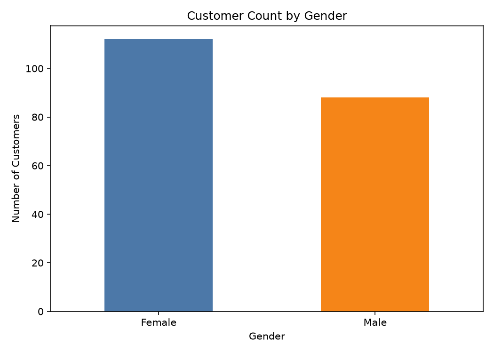
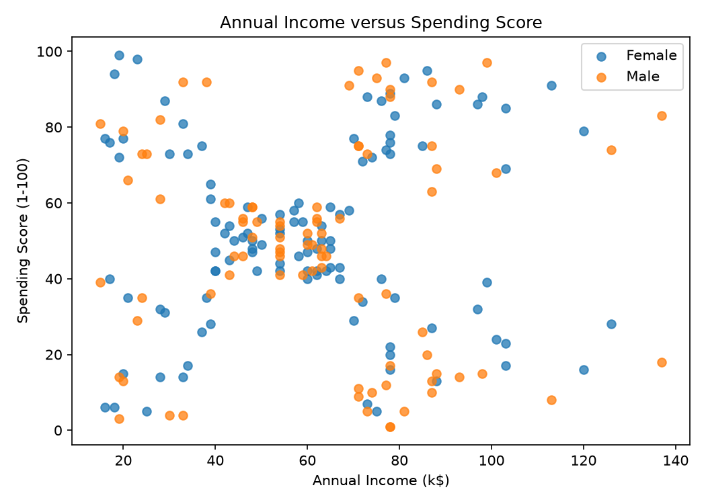

# Mall Customer EDA Report

**Student:** Priyanshu Yadav  
**Admission No:** 2026B01010276  
**Course:** B.Tech CSE, First Year  
**Training:** HCL Data Analytics Training

## Dataset and Inspection

- Source: `data/raw/Mall_Customers.csv`
- Shape: 200 rows and 5 original columns
- Original columns: CustomerID, Gender, Age, Annual Income (k$), Spending Score (1-100)

### head()

|   CustomerID | Gender   |   Age |   Annual Income (k$) |   Spending Score (1-100) |
|-------------:|:---------|------:|---------------------:|-------------------------:|
|            1 | Male     |    19 |                   15 |                       39 |
|            2 | Male     |    21 |                   15 |                       81 |
|            3 | Female   |    20 |                   16 |                        6 |
|            4 | Female   |    23 |                   16 |                       77 |
|            5 | Female   |    31 |                   17 |                       40 |

### tail()

|   CustomerID | Gender   |   Age |   Annual Income (k$) |   Spending Score (1-100) |
|-------------:|:---------|------:|---------------------:|-------------------------:|
|          196 | Female   |    35 |                  120 |                       79 |
|          197 | Female   |    45 |                  126 |                       28 |
|          198 | Male     |    32 |                  126 |                       74 |
|          199 | Male     |    32 |                  137 |                       18 |
|          200 | Male     |    30 |                  137 |                       83 |

### shape

(200, 5)

### info()

```text
<class 'pandas.DataFrame'>
RangeIndex: 200 entries, 0 to 199
Data columns (total 6 columns):
 #   Column                  Non-Null Count  Dtype   
---  ------                  --------------  -----   
 0   CustomerID              200 non-null    int64   
 1   Gender                  200 non-null    str     
 2   Age                     200 non-null    int64   
 3   Annual Income (k$)      200 non-null    int64   
 4   Spending Score (1-100)  200 non-null    int64   
 5   Age Band                200 non-null    category
dtypes: category(1), int64(4), str(1)
memory usage: 8.2 KB

```

### describe()

|        |   CustomerID | Gender   |     Age |   Annual Income (k$) |   Spending Score (1-100) |
|:-------|-------------:|:---------|--------:|---------------------:|-------------------------:|
| count  |     200      | 200      | 200     |             200      |                 200      |
| unique |     nan      | 2        | nan     |             nan      |                 nan      |
| top    |     nan      | Female   | nan     |             nan      |                 nan      |
| freq   |     nan      | 112      | nan     |             nan      |                 nan      |
| mean   |     100.5    | nan      |  38.85  |              60.56   |                  50.2    |
| std    |      57.8792 | nan      |  13.969 |              26.2647 |                  25.8235 |
| min    |       1      | nan      |  18     |              15      |                   1      |
| 25%    |      50.75   | nan      |  28.75  |              41.5    |                  34.75   |
| 50%    |     100.5    | nan      |  36     |              61.5    |                  50      |
| 75%    |     150.25   | nan      |  49     |              78      |                  73      |
| max    |     200      | nan      |  70     |             137      |                  99      |

## Required Analysis

### 1. Customers by Gender

| Gender   |   Customer Count |
|:---------|-----------------:|
| Female   |              112 |
| Male     |               88 |

### 2. Numerical Summary

|                        |   mean |   median |   minimum |   maximum |
|:-----------------------|-------:|---------:|----------:|----------:|
| Age                    |  38.85 |     36   |        18 |        70 |
| Annual Income (k$)     |  60.56 |     61.5 |        15 |       137 |
| Spending Score (1-100) |  50.2  |     50   |         1 |        99 |

The NumPy-based summary is also available in `outputs/numpy_summary.csv`.

### 3. Highest-Spending Age Band

Age bands used: 18-27, 28-37, 38-47, 48-57, 58-67, and 68+.

| Age Band   |   Customer Count |   Average Spending Score |
|:-----------|-----------------:|-------------------------:|
| 18-27      |               46 |                  55.6304 |
| 28-37      |               61 |                  61.5902 |
| 38-47      |               36 |                  41.3333 |
| 48-57      |               31 |                  39.1613 |
| 58-67      |               20 |                  35.95   |
| 68+        |                6 |                  50.5    |

The age band with the highest average spending score is **28-37** (61.59).

### 4. Gender Comparison

| Gender   |   Average Annual Income (k$) |   Average Spending Score |
|:---------|-----------------------------:|-------------------------:|
| Female   |                      59.25   |                  51.5268 |
| Male     |                      62.2273 |                  48.5114 |

### 5. Top 10 Customers by Spending Score

|   CustomerID | Gender   |   Age |   Annual Income (k$) |   Spending Score (1-100) | Age Band   |
|-------------:|:---------|------:|---------------------:|-------------------------:|:-----------|
|           12 | Female   |    35 |                   19 |                       99 | 28-37      |
|           20 | Female   |    35 |                   23 |                       98 | 28-37      |
|          146 | Male     |    28 |                   77 |                       97 | 28-37      |
|          186 | Male     |    30 |                   99 |                       97 | 28-37      |
|          128 | Male     |    40 |                   71 |                       95 | 38-47      |
|          168 | Female   |    33 |                   86 |                       95 | 28-37      |
|            8 | Female   |    23 |                   18 |                       94 | 18-27      |
|          142 | Male     |    32 |                   75 |                       93 | 28-37      |
|          164 | Female   |    31 |                   81 |                       93 | 28-37      |
|           34 | Male     |    18 |                   33 |                       92 | 18-27      |

### 6. Data Quality

- Missing values: 0
- Duplicate rows: 0

Missing values by column:

| Column                 |   Missing Values |
|:-----------------------|-----------------:|
| Age                    |                0 |
| Annual Income (k$)     |                0 |
| Spending Score (1-100) |                0 |
| Gender                 |                0 |
| CustomerID             |                0 |

## Charts





## Observations

1. Female customers form the larger gender group, with 112 customers.
2. The 28-37 age band has the highest average spending score (61.59).
3. Average annual income is 59.25k for females and 62.23k for males; both groups should be compared with their average spending scores.
